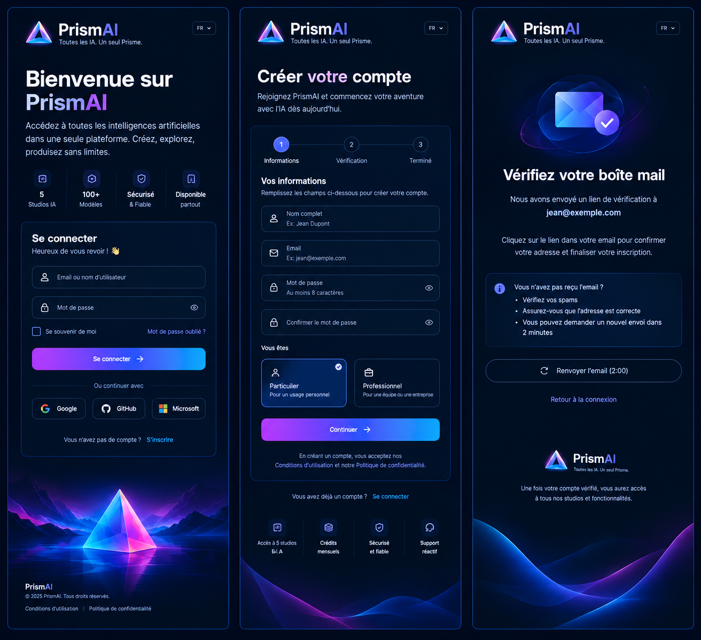

# Référence frontend PrismAI

## Source

Cette référence provient du fichier partagé dans Google Drive, qui renvoie vers la conversation publique intitulée « Triptyque PrismAI néon futuriste ». L’image a été enregistrée dans [`docs/assets/prismai-frontend-reference.png`](assets/prismai-frontend-reference.png) afin de rendre le cadrage visuel versionné et accessible au projet.

## Écrans observés

La composition présente trois écrans mobiles côte à côte. Le premier est un écran de connexion avec la promesse « Bienvenue sur PrismAI », un résumé des capacités, les champs d’identification, les boutons OAuth et l’accès à l’inscription. Le deuxième est un parcours de création de compte en trois étapes : informations, vérification et terminé. Le troisième confirme l’envoi de l’e-mail de vérification et propose le renvoi du message ainsi que le retour à la connexion.

## Direction visuelle à reproduire

Le fond principal est bleu nuit presque noir, avec des surfaces légèrement plus claires pour les cartes. Les contours utilisent un bleu électrique fin. Les appels à l’action utilisent un dégradé violet vers bleu puis cyan. Les textes principaux sont blancs, les textes secondaires bleu-gris et les accents de marque violet/cyan.

Le logo est un prisme triangulaire lumineux combinant cyan, bleu, violet et rose. Les éléments décoratifs inférieurs utilisent des vagues abstraites néon et un paysage de prisme pour renforcer l’identité sans surcharger les formulaires.

La hiérarchie doit rester mobile-first : logo et sélecteur de langue en haut, titre court, description concise, formulaire dans une carte lisible, action principale pleine largeur, liens secondaires distincts et aide facilement accessible. Les états focus, erreur, chargement, désactivation et validation devront être prévus dès l’implémentation.

## Contraintes d’implémentation

La maquette est une référence de style et de composition, pas une copie pixel par pixel. Les textes devront rester accessibles et cohérents avec le cahier des charges. Les composants seront réutilisables entre connexion, inscription, vérification e-mail et futures pages du tableau de bord.

Aucun logo ou asset propriétaire externe n’a été ajouté en dehors de l’image de référence. Le logo PrismAI pourra être reconstruit comme composant visuel interne ou remplacé par un asset validé avant la mise en production.

## Prochaine unité frontend

La prochaine unité pourra créer le shell web et les trois états d’authentification en environnement local, avec une vérification responsive, clavier, contraste, états d’erreur et mise à jour du README avant publication.
